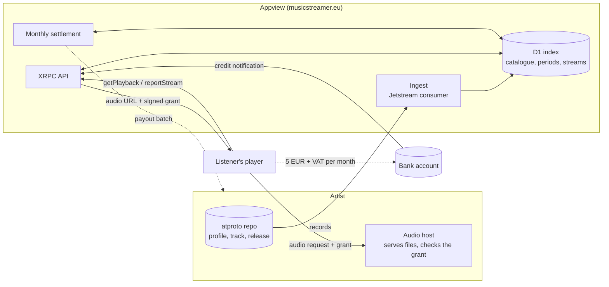
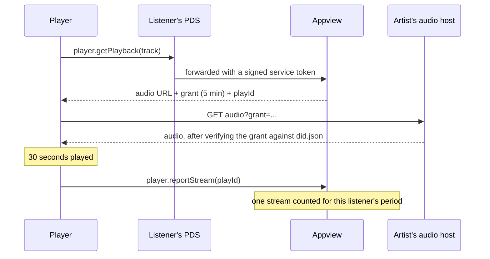
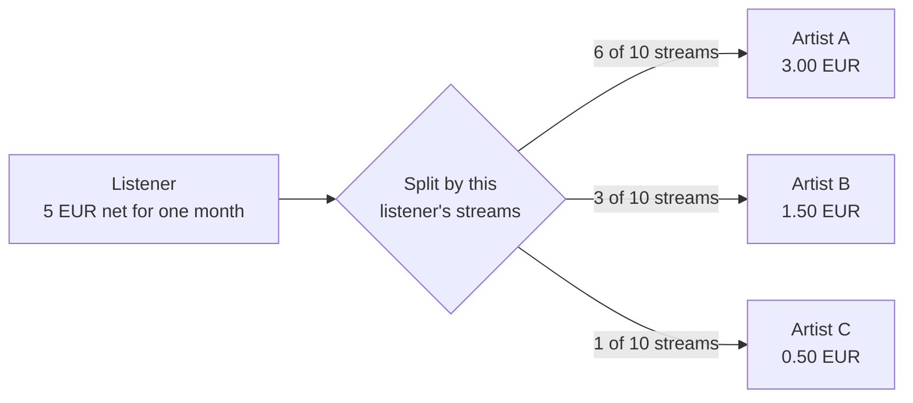

<p>
  <picture>
    <source media="(prefers-color-scheme: dark)" srcset="brand/logo-dark.svg">
    
  </picture>
</p>

# musicstreamer.eu

**Status: proposal.** Nothing here is live.

An atproto-based music streaming appview. Artists host their own audio and publish metadata as
atproto records in their own repo. Listeners pay €5 plus VAT per month by bank transfer, and each
listener's €5 is split by stream count among the tracks that listener streamed. A non-profit
association operates it and takes no cut.

The specification is [`docs/plan.md`](docs/plan.md). Audio hosts implement
[`docs/playback-grant.md`](docs/playback-grant.md).

## How it works

**Architecture**



**Playing a track**



**Where one listener's 5 EUR goes**



Illustrative numbers. A stream counts after 30 seconds, or half the track if it is shorter than 60 seconds.

## Layout

| Path | Contents |
|---|---|
| `docs/plan.md` | the plan (authoritative) |
| `docs/playback-grant.md` | how an audio host verifies the `?grant=` JWT |
| `lexicons/eu/musicstreamer/` | lexicon JSON: records and XRPC methods (plus shared `defs`) |
| `appview/` | Cloudflare Worker: XRPC API, Jetstream ingest (Durable Object), track verification (Queue), settlement (Cron), D1 schema in `migrations/0001_init.sql` |
| `brand/` | logo, mark and the identity notes |
| `site/` | static SvelteKit landing page (German and English) |

## Build

Requires Node and pnpm.

```sh
pnpm install
pnpm typecheck
pnpm build        # wrangler deploy --dry-run for appview, vite build for site
```

Nothing is deployed by these commands.

## Configuring the appview

`appview/wrangler.jsonc` contains placeholder IDs and `vars` (service account DID and PDS URL,
Wise profile and balance IDs, bank IBAN and account holder). Replace them before deploying.

Secrets (names only, see `appview/.dev.vars.example`):

- `ADMIN_SECRET` — bearer token for `/admin/*`
- `GRANT_PRIVATE_JWK` — ES256 (P-256) private key as JWK; the public half is served in `did.json`
- `PLAY_TOKEN_SECRET` — HMAC key for `playId` tokens
- `SERVICE_HANDLE`, `SERVICE_APP_PASSWORD` — service account that publishes `actor.verification` and `settlement.statement` records
- `WISE_API_TOKEN`, `WISE_WEBHOOK_PUBLIC_KEY`

Set them with `wrangler secret put <NAME>`; never commit values.

## License

MIT, see [LICENSE](LICENSE).
