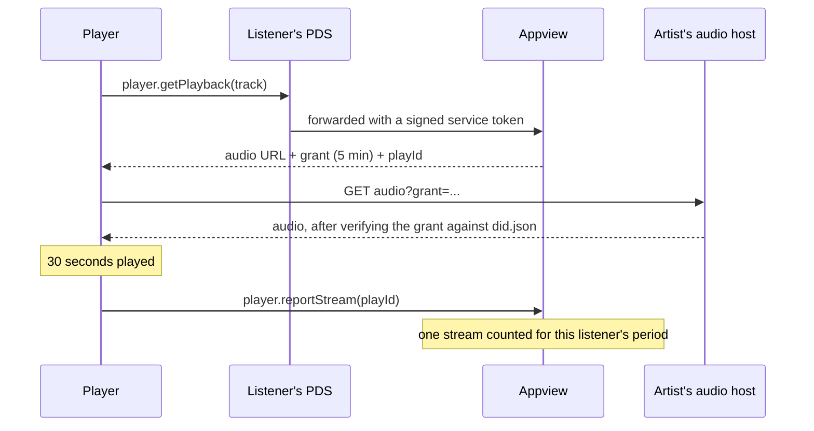

<h1 align="center">
  <picture><source media="(prefers-color-scheme: dark)" srcset="brand/logo-dark.svg"></picture>
</h1>

<p align="center"><strong>Music streaming where your 5 euros go to the artists you played.</strong><br>Artists host their own audio. An open appview on atproto counts streams and settles monthly. No cut.</p>

<p align="center">
  <a href="docs/plan.md">Plan</a> ·
  <a href="docs/player-plan.md">Player plan</a> ·
  <a href="lexicons/">Lexicons</a> ·
  <a href="appview/">Appview</a> ·
  <a href="brand/">Identity</a>
</p>

> **Status: proposal.** Nothing here is live. The plan, the lexicons and a first appview are public so they can be discussed.

## How it works

### Where your 5 euros go

Each listener pays 5 € plus VAT per month by bank transfer. That listener's 5 € is divided among the tracks they streamed, by stream count. A stream counts after 30 seconds, or half the track if it is shorter than 60 seconds.

<p align="center"><picture><source media="(prefers-color-scheme: dark)" srcset="brand/diagrams/flow-dark.svg"></picture></p>

### Why that is different

In a big-pot model all subscription money is pooled and shared by total streams, so your money also pays artists you never played. Here it only reaches the artists you chose.

<p align="center"><picture><source media="(prefers-color-scheme: dark)" srcset="brand/diagrams/pot-dark.svg"></picture></p>

### Architecture

Artists publish profile, track and release records in their own atproto repository and serve the audio from their own host. The appview indexes the records, signs short-lived playback grants, counts streams and settles each month. It never stores audio.

<p align="center"><picture><source media="(prefers-color-scheme: dark)" srcset="brand/diagrams/architecture-dark.svg"></picture></p>

<details>
<summary><strong>Protocol detail: playing a track</strong></summary>



</details>

## Principles

| | |
|---|---|
| **Zero cut** | A non-profit operator takes nothing; fixed costs are covered by grants and donations. |
| **Humans only** | Every artist is a verified person or collective. No AI-generated music. |
| **Public statements** | Each month's totals and per-track stream counts are published as an atproto record. |
| **Open** | Code and lexicons are open source; anyone can run another appview. |

## Layout

| Path | Contents |
|---|---|
| `docs/plan.md` | the plan (authoritative) |
| `docs/playback-grant.md` | how an audio host verifies the `?grant=` JWT |
| `lexicons/eu/musicstreamer/` | lexicon JSON: records and XRPC methods (plus shared `defs`) |
| `appview/` | Cloudflare Worker: XRPC API, Jetstream ingest (Durable Object), track verification (Queue), settlement (Cron), D1 schema in `migrations/0001_init.sql` |
| `brand/` | logo, mark and the identity notes |
| `site/` | static SvelteKit landing page (German and English) |
| `player/` | the player apps: SvelteKit web app and artist studio, Tauri desktop shell (`src-tauri/`), Capacitor Android and iOS shells and native audio plugin; see `docs/player-plan.md` |

## Build

Requires Node and pnpm.

```sh
pnpm install
pnpm typecheck
pnpm build        # wrangler deploy --dry-run for appview, vite build for site and player
```

Nothing is deployed by these commands.

## Configuring the appview

`appview/wrangler.jsonc` contains placeholder IDs and `vars` (service account DID and PDS URL,
Wise profile and balance IDs, bank IBAN and account holder). Replace them before deploying.

Secrets (names only, see `appview/.dev.vars.example`):

- `ADMIN_SECRET` — bearer token for `/admin/*`
- `GRANT_PRIVATE_JWK` — ES256 (P-256) private key as JWK; the public half is served in `did.json`
- `PLAY_TOKEN_SECRET` — HMAC key for `playId` tokens
- `SERVICE_HANDLE`, `SERVICE_APP_PASSWORD` — service account that publishes `actor.verification` and `settlement.statement` records
- `WISE_API_TOKEN`, `WISE_WEBHOOK_PUBLIC_KEY`

Set them with `wrangler secret put <NAME>`; never commit values.

## License

MIT, see [LICENSE](LICENSE).
